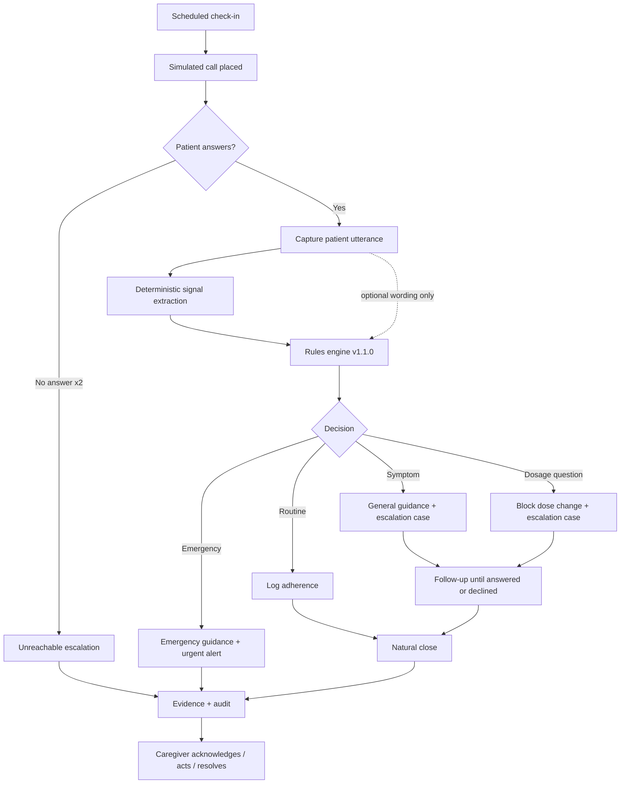
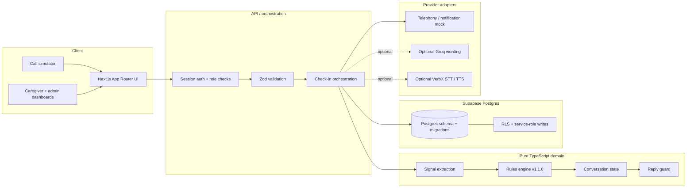
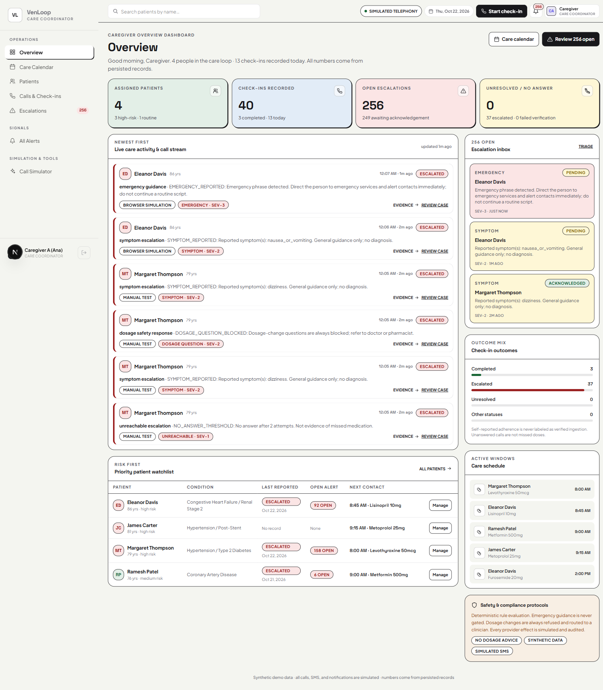
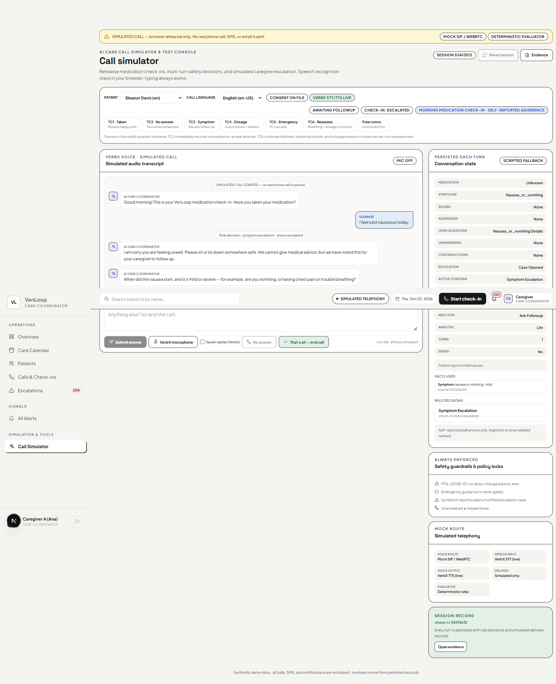
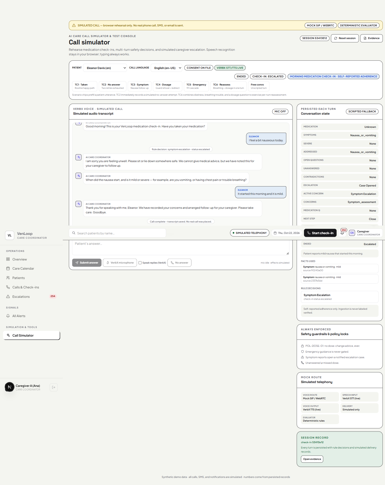
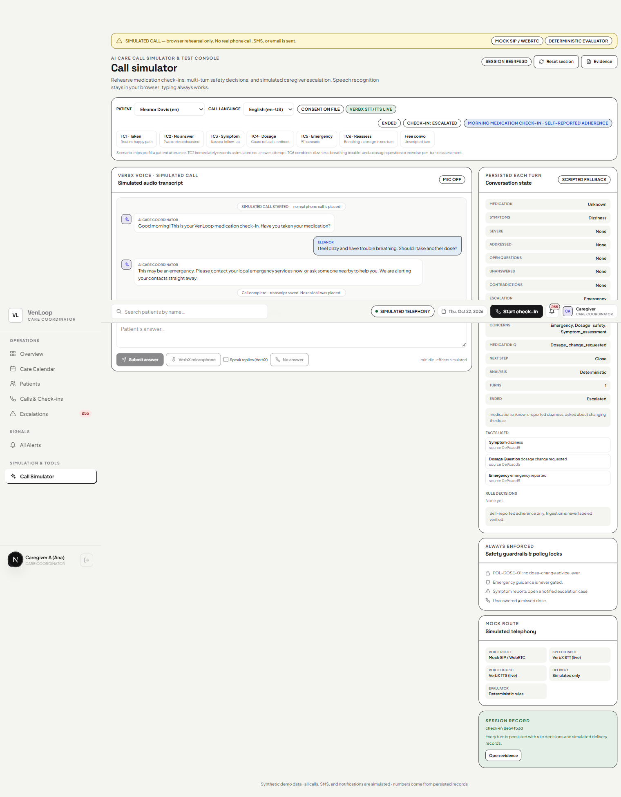
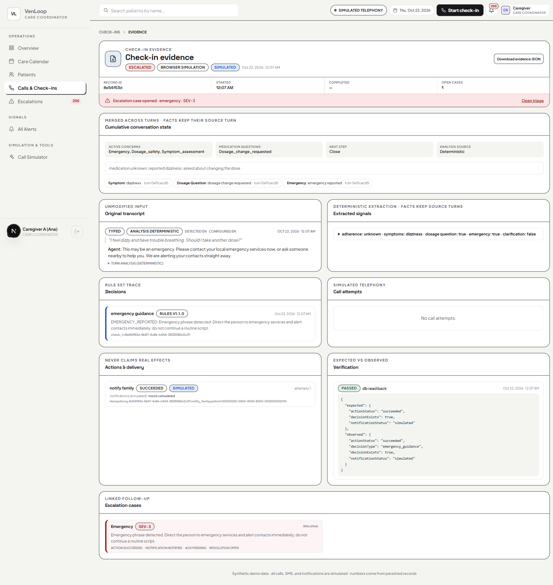
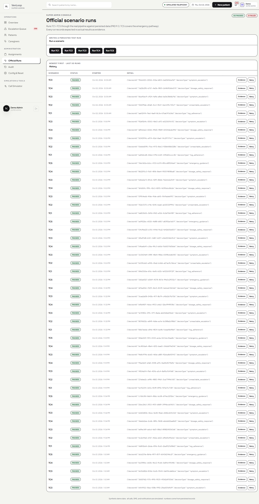

# VenLoop

**A medication check-in call that listens, remembers, and escalates safely.**

VenLoop places a simulated morning check-in call to an older adult, follows up on what they actually say, and gives a caregiver a complete evidence trail: transcript, extracted facts, deterministic decision, simulated notification, and an open case when a human needs to act.

> **Synthetic demo. Not a medical device.** Every call, SMS, notification, and caregiver alert in this repository is simulated unless real providers are explicitly configured. VenLoop never gives diagnosis or dosage advice.

<p>
  
  
  
  
  
</p>

## Demo assets

| Asset | Link |
|---|---|
| Live demo | `ADD_LIVE_DEMO_URL` |
| Demo video | `ADD_DEMO_VIDEO_URL` |
| Presentation / slide deck | `ADD_PRESENTATION_URL` |

These are placeholders on purpose. Add the real URLs after recording/deploying; nothing in this README claims that a hosted demo already exists.

---

## Why this exists

A missed medication check-in is not one problem. It is a chain of small uncertainties:

- Did the person take the medication?
- Did they understand the question?
- Did they mention dizziness, chest pain, or a dosage question?
- Did anyone actually respond to the alert?
- Can a caregiver prove what happened afterward?

Most demos stop at "the AI said something." VenLoop is built around the harder part: **a safety decision that can be inspected after the call.**

## What makes it different

### 1. Deterministic safety, with language on top

The rules engine is the authority. It decides adherence, symptom escalation, dosage blocking, emergency routing, and no-answer handling. An optional LLM layer only produces natural wording and extracts facts; it cannot change a decision, open a case, or write medication state.

If the model is missing, slow, malformed, or unsafe, the call falls back to scripted text. Official fixture runs never use the LLM.

### 2. Cumulative state, not one-shot classification

Every patient turn is folded into persistent conversation state. Facts keep their source turn. New red flags upgrade the assessment without downgrading an open concern. A symptom question cannot silently disappear; it must be answered or explicitly declined.

### 3. Dosage questions are always blocked

No language, wording, or model output can turn "should I double my dose?" into advice. VenLoop says it cannot advise on dose changes, routes the question to a clinician/pharmacist, and records the decision.

### 4. Evidence is the product

The evidence console shows the original transcript, extracted signals, rule trace, simulated delivery attempts, expected-vs-observed verification, and the linked escalation case. Caregivers acknowledge, act, and resolve with a note. Every state change stays auditable.

### 5. Simulated by design

The UI labels the database, calls, and notifications as simulated. Mock adapters share the provider interfaces a real implementation would use, so the demo never pretends a phone call or SMS happened.

## Product walkthrough



## Architecture



The app is a modular monolith. Domain code has no React, Next, or Supabase imports, so the safety logic can be tested without a browser or network.

## Screenshots

### Caregiver overview

Persisted metrics only. No invented adherence numbers.



### A natural symptom follow-up, then a clean close

The patient reports nausea. VenLoop asks onset/severity, records the answer against the source turn, and closes without a scripted "anything else?" loop.





### Emergency reassessment

Dizziness plus "trouble breathing" plus a dosage question becomes one emergency path. The call ends with emergency guidance, not a generic follow-up.



### Evidence console

Transcript, cumulative state, fact source turns, rule trace, simulated delivery, verification, and the linked case in one view.



### Official scenario history

TC1–TC5 run through the real pipeline. The screenshot below shows 50 passed / 0 failed at capture time.



## Verified results

Last verified locally: **22 Oct 2026**.

| Check | Command | Result |
|---|---|---|
| Lint | `pnpm lint` | Exit 0 |
| Types | `pnpm typecheck` | Exit 0 |
| Unit + integration | `pnpm test` | **89 passed / 10 files** |
| Browser E2E | `pnpm test:e2e` | **9 passed** |
| Production build | `pnpm build` | Exit 0, 35 static pages generated |
| Official scenarios | Admin → Official runs | TC1–TC5 passing through the real pipeline |

The DB-backed integration suites need `SUPABASE_SERVICE_ROLE_KEY` and a running local Supabase. Without it they skip in CI; the rest still run.

### Official scenario coverage

| ID | Scenario | Expected decision | Status |
|---|---|---|---|
| TC1 | "Yes, I took my morning tablets." | `log_adherence` | Passing |
| TC2 | No answer after two attempts | `unreachable_escalation` | Passing |
| TC3 | "I feel a bit dizzy today." | `symptom_escalation` | Passing |
| TC4 | "Should I double the dose?" | `dosage_safety_response` | Passing |
| TC5 | Emergency phrase (demo) | `emergency_guidance` | Passing |

The simulator also includes **TC6**, a one-turn reassessment demo combining dizziness, breathing trouble, and a dosage question. TC6 is a demo scenario, not an official PRD test ID.

## Features

- **Caregiver dashboard**: assigned patients, check-ins, open cases, priority watchlist, schedule.
- **Patient detail**: medications, care plan, calendar, care logs, contacts, care notes.
- **Call simulator**: English / Hindi / Marathi selector, scenario chips, browser speech fallback, optional VerbX voice, persistent simulated labeling.
- **Cumulative conversation state**: symptoms, severity, addressed/unanswered questions, contradictions, escalation, facts with source turn IDs.
- **Escalation cases**: acknowledge → category action → resolve with note.
- **Evidence console**: rule trace, original transcript, extracted signals, delivery attempts, expected-vs-observed verification, JSON export.
- **Admin console**: caregivers, patients, assignments, cross-patient cases, official runs, audit, config presence, demo reset.
- **Auth + authorization**: session-based roles, server-side checks, RLS as a second line.

### Multilingual behavior

- Scripted copy exists for English, Hindi, and Marathi.
- With VerbX configured, typed non-English input can be translated for extraction, and replies can be spoken.
- Without VerbX, non-English speech falls back to browser recognition; the app never guesses adherence from an untranslated sentence.
- VerbX TTS and translation were verified live. VerbX STT was unavailable upstream during verification (`provider_outage`), so live STT is **not verified**.

## Tech stack

| Layer | Choice |
|---|---|
| App | Next.js 16.4 (App Router), React 19 |
| Language | TypeScript strict |
| Styling | Tailwind CSS 4 |
| Validation | Zod |
| Database / auth | Supabase (local Postgres + RLS) |
| Unit / integration | Vitest |
| Browser E2E | Playwright |
| Optional wording | Groq (OpenAI-compatible JSON mode) |
| Optional voice | VerbX STT / TTS / translation |

## Quickstart

Prerequisites: Node 22+, pnpm 11+, Docker Desktop.

```bash
pnpm install
cp .env.example .env.local   # fill Supabase values after db:start
pnpm db:start                # local Supabase
pnpm db:reset                # migrations + deterministic seed
pnpm dev                     # http://localhost:3000
```

### Demo accounts

| Role | Email | Password |
|---|---|---|
| Caregiver | `caregiver.a@venloop.demo` | `venloop-demo-123` |
| Caregiver | `caregiver.b@venloop.demo` | `venloop-demo-123` |
| Super-admin | `admin@venloop.demo` | `venloop-demo-123` |

All patients, medications, and records are synthetic seed data.

### Useful scripts

```bash
pnpm lint
pnpm typecheck
pnpm test
pnpm test:e2e
pnpm build
pnpm db:start / pnpm db:stop / pnpm db:reset
pnpm db:migrate <name>
```

`pnpm test:e2e` expects a running app at `E2E_BASE_URL` (default `http://localhost:3000`).

## Configuration

Copy `.env.example` to `.env.local`. Never commit real secrets.

| Variable | Required | Purpose |
|---|---|---|
| `NEXT_PUBLIC_APP_URL` | Yes | Local or deployed origin |
| `NEXT_PUBLIC_SUPABASE_URL` | Yes | Supabase project URL |
| `NEXT_PUBLIC_SUPABASE_ANON_KEY` | Yes | Browser-safe anon key |
| `SUPABASE_SERVICE_ROLE_KEY` | Yes (server) | Admin operations; never expose to the client |
| `LLM_PROVIDER` / `GROQ_API_KEY` | Optional | Natural wording; empty key = scripted replies |
| `SPEECH_PROVIDER` / `VERBX_API_KEY` | Optional | Server-side STT/TTS/translation |
| `TELEPHONY_PROVIDER` / `NOTIFICATION_PROVIDER` | Demo | Keep `mock` |
| `ENABLE_REAL_TELEPHONY` / `ENABLE_REAL_NOTIFICATIONS` | Demo | Keep `false` |

## Deployment

Requires Node 22+ and a hosted Supabase project.

1. Create a Supabase project and apply migrations:
   ```bash
   supabase link --project-ref <ref>
   supabase db push
   ```
2. Set the env vars from `.env.example` in your host:
   - `NEXT_PUBLIC_SUPABASE_URL`, `NEXT_PUBLIC_SUPABASE_ANON_KEY`
   - `SUPABASE_SERVICE_ROLE_KEY` (server-only)
   - `NEXT_PUBLIC_APP_URL` = deployed origin
   - Keep mock providers and `ENABLE_REAL_*` false for the simulated demo
   - Add `GROQ_API_KEY` only if you want natural wording
3. Build and start: `pnpm build && pnpm start`.
4. Run a deployment smoke test: login, simulator TC1, simulator TC3, evidence page. Deployment smoke tests are not yet recorded in this repository.

## Security and safety posture

- Server-side role checks on protected routes; RLS scopes caregiver reads to assigned patients.
- All external input is validated with Zod.
- Service-role key remains server-side; `.env*` is ignored except `.env.example`.
- The deterministic rules engine owns every safety decision; the LLM is an optional phrasing layer.
- Reply guard rejects dosage instructions, milligram amounts, diagnoses, unbacked alert claims, and non-emergency emergency-number references.
- Mock adapters are labeled `simulated`; no real call/SMS/notification is claimed.
- Audit events record state transitions and caregiver actions.

## Known limitations

- Not clinically validated. Do not use with real patients.
- Real telephony and notifications are intentionally not enabled.
- Deployment target and smoke tests are not configured yet.
- VerbX STT was unavailable upstream during verification; browser speech is the fallback.
- Rate limiting and LLM concurrency caps are per-process, not distributed.
- Official failure-injection coverage is partial: provider timeout and DB-down scenarios are not injected.
- TC6 is a simulator demo, not an official PRD test case.
- Screenshots contain synthetic demo records only.

## Documentation

- [PRD](prd.md)
- [Architecture](docs/architecture.md)
- [Data model](docs/data-model.md)
- [Safety policy](docs/safety-policy.md)
- [Implementation status](docs/implementation-status.md)

---

Built for the VenLoop hackathon demo. Synthetic data. Simulated effects. Deterministic safety.
