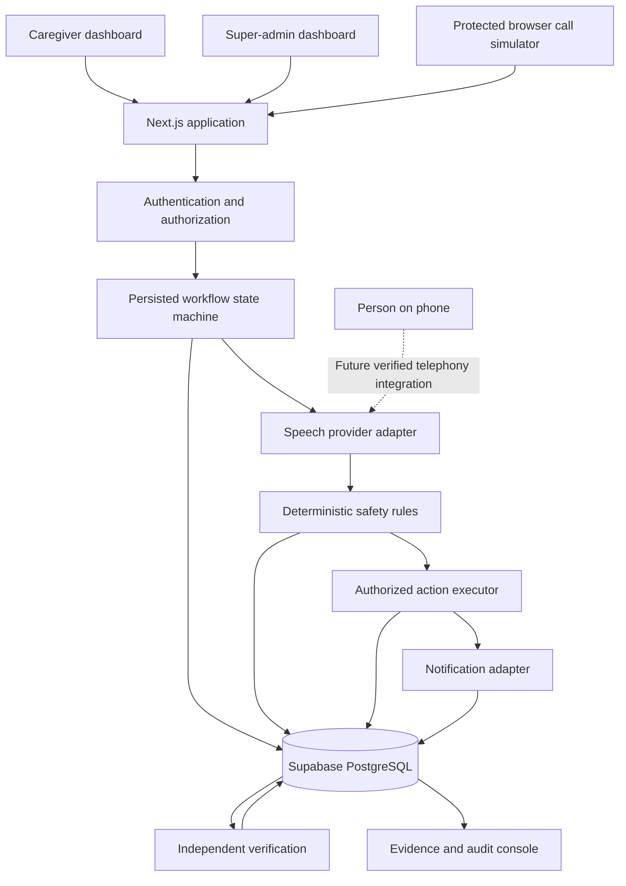

# VenLoop — Product Requirements Document (PRD)

**Version:** 1.0  
**Status:** Approved implementation specification  
**Project:** Ziro Healthcare & Wellness AI Challenge  
**Product:** Elder Medication Check-in Caller  
**Primary objective:** Build a deployed, auditable, multilingual medication check-in agent with caregiver oversight, deterministic safety rules, and independently verifiable outcomes.

---

# 1. Executive Summary

VenLoop is an AI-assisted medication check-in system designed to contact elderly people, collect their reported medication adherence and symptoms, apply safety rules, notify authorized caregivers when necessary, and maintain a verifiable history of each interaction.

The elderly person does not need to use an application, create an account, or navigate a dashboard. In the intended product, the person interacts through an ordinary telephone conversation. During the hackathon, a browser-based voice simulator will reproduce the patient side of that interaction.

VenLoop has two operational dashboards:

1. **Caregiver Dashboard:** Allows relatives and caregivers to monitor assigned patients, configure schedules and contacts, review check-in logs, handle alerts, and approve actions where required.
2. **Super-Admin Dashboard:** Allows authorized platform administrators to manage caregivers, patients, assignments, agent configurations, system health, test runs, and audit records.

The core system consists of a deterministic rules engine, persistent workflow state, speech-provider adapters, an authorized action executor, and independent verification.

## Product differentiators

- **Proof-Carrying Care:** Every important outcome has traceable evidence, a decision reason, and a verification result.
- **Reflex-First AI:** Routine decisions use deterministic rules without unnecessary LLM calls.
- **Multilingual Safety:** Preserve the original transcript, distinguish adherence from symptoms and dosage questions, and never generate medication dosage-change advice.
- **Honest Execution:** Simulated, pending, failed, unconfirmed, and verified actions are represented distinctly.

## Important scope boundary

The initial deployment is a synthetic-data hackathon demonstration. It must be designed with production-oriented coding and security practices, but it must not be represented as clinically validated or production-ready for real patients.

Actual outbound telephone calls are not assumed to work until a compatible provider and its API, destination-country support, audio integration, cost, and operating requirements have been verified.

---

# 2. Goals and Success Criteria

## 2.1 Primary goals

1. Deliver a working deployed VenLoop application.
2. Support separate caregiver and super-admin experiences.
3. Demonstrate a patient-style spoken conversation without requiring a patient dashboard.
4. Implement all four official test cases.
5. Store decisions, action states, approvals, and verification evidence persistently.
6. Verify database outcomes independently from the code that initiated the write.
7. Provide an understandable audit trail for judges.
8. Operate within a ₹0 recurring development budget using free tiers and synthetic data.
9. Keep voice, telephony, and notification integrations replaceable.
10. Establish a clear path from the hackathon implementation to a more robust production architecture.

## 2.2 Success metrics

The following are MVP acceptance targets, not claims of clinical effectiveness.

- 100% of the four official scenarios produce the expected rule-engine classification in deterministic tests.
- 100% of successful test runs have an input, expected result, actual result, and evidence reference.
- No scenario may claim success if its required persistence or verification step fails.
- Repeating an action request with the same idempotency key must not create duplicate logical actions.
- Unauthorized users must not be able to read or modify records outside their permissions.
- Dosage-change requests must never produce dosage-change recommendations.
- Unclear or invalid inputs must lead to clarification or an unresolved state, not a guessed clinical conclusion.
- Simulated calls and notifications must always be distinguishable from real integrations.
- All four official scenarios must run against the deployed application.
- The primary demonstration must work without requiring paid API credits.

## 2.3 Non-goals

The MVP will not:

- Diagnose medical conditions.
- Prescribe medication or recommend dosage changes.
- Claim to verify that a person physically swallowed medication.
- Automatically modify medication schedules based on conversation.
- Replace doctors, pharmacists, emergency services, or clinical judgment.
- Provide a patient-facing web dashboard or require elderly users to operate an app.
- Depend on a paid telephony service.
- Require an autonomous multi-agent architecture.
- Require a vector database, RAG pipeline, or general-purpose LLM.
- Implement billing, subscriptions, enterprise provisioning, or a commercial multi-tenant SaaS billing system.
- Claim that the mock notification sink sends actual messages.
- Claim that a browser voice session is a real telephone call.

---

# 3. Users, Roles, and Permissions

## 3.1 Elderly person

The elderly person is the subject of a check-in, not an application user.

### Intended interaction

1. Receives a scheduled telephone call or calls an approved inbound telephone number, once telephony is implemented.
2. Hears a greeting in their configured language.
3. Answers the medication check-in question naturally.
4. Can mention symptoms or ask questions.
5. Receives a safe conversational response.
6. Ends the conversation.

### Hackathon representation

A protected browser-based call simulator allows the developer or judge to impersonate the elderly person.

The simulator is a testing interface, not a patient dashboard. It must be labelled clearly as a simulated call.

### Requirements

- No patient login required for the simulated interaction.
- Large, readable text.
- Clear microphone status.
- Ability to start, end, and repeat a simulated call.
- Language selection from configured supported languages.
- Text-input fallback.
- Clear indication when voice recognition is unavailable.
- No real patient information in the demo.

## 3.2 Caregiver or relative

Caregivers must authenticate.

A caregiver may:

- View patients explicitly assigned to them.
- View permitted patient schedules and contact information.
- Configure medication schedules and check-in times.
- Configure authorized notification contacts and escalation policies.
- Record and manage consent information.
- View check-in histories and reported adherence.
- View symptoms and unresolved cases.
- Review notifications and their delivery status.
- Approve or reject actions when the applicable policy requires approval.
- Inspect decision explanations and verification evidence.

A caregiver may not:

- Access unassigned patients.
- Promote themselves to super-admin.
- Change audit records.
- Override a safety restriction to permit dosage advice.
- Mark an unverified action as successful.
- Delete evidence to conceal a failure.

## 3.3 Super-admin

Super-admins authenticate using a separately assigned privileged role.

They may:

- View platform-level synthetic-data metrics.
- Create, disable, and manage caregiver accounts.
- Create and manage patient records.
- Assign caregivers to patients.
- Configure supported agent profiles and channels.
- Configure or disable integration providers.
- Inspect workflow failures and verification mismatches.
- Manage rule-set versions and feature flags.
- Run official test scenarios.
- Reset synthetic demo data.
- Export test evidence.
- Review privileged changes and audit events.

They must not have an unrestricted ability to silently rewrite past audit events.

Super-admin operations must be authenticated, authorized server-side, and audited.

## 3.4 Role enforcement

Use server-side authorization for every protected operation. Frontend route guards alone are insufficient.

Use PostgreSQL row-level security where applicable, and validate authorization in server-side business logic.

The initial role set is:

- `caregiver`
- `super_admin`

The elderly person does not have an application account in the MVP.

---

# 4. Technology Stack

Use the following stack unless an implementation blocker is discovered and documented.

| Layer | Technology | Reason |
|---|---|---|
| Application | Next.js App Router | One application for dashboards, API routes, and demo tools |
| Language | TypeScript with strict mode | Static checks for business rules and structured data |
| UI | React + Tailwind CSS | Rapid, consistent, accessible interface development |
| Components | Accessible reusable components; shadcn/ui where useful | Consistent dashboard UI without introducing a separate design system |
| Database | Supabase PostgreSQL | Managed relational database and persistent records |
| Authentication | Supabase Auth | Managed caregiver and administrator identity |
| Authorization | Server-side checks + PostgreSQL RLS | Enforce tenant and role boundaries |
| Validation | Zod | Validate all external inputs and structured provider output |
| Voice demo | Browser Web Speech APIs behind an adapter | Avoid mandatory speech API charges |
| Optional speech provider | VerbX adapter | Use only after API access, quality, latency, and credit usage are validated |
| Decision logic | Pure TypeScript rules engine | Deterministic and testable safety decisions |
| Workflow | Persisted application state machine | Sufficient for the synthetic MVP |
| Testing | Vitest + React Testing Library + Playwright | Unit, component, integration, and end-to-end testing |
| Hosting | Vercel Hobby, if permitted by applicable terms | Managed hosting for a synthetic non-commercial demo |
| Database hosting | Supabase Free | Managed PostgreSQL for the demo |
| CI | GitHub Actions free allowance, if available | Automated quality checks and test execution |
| Browser automation service | Not required initially | Local/CI Playwright is sufficient |
| LLM orchestration | Not required initially | Explicit rules are sufficient for the four required scenarios |
| Telephony | Mock adapter initially | Actual provider is unverified and may require payment |

## 4.1 Technology selection rules

- Do not introduce a second backend framework without a demonstrated need.
- Do not add n8n, Temporal, a vector database, or a multi-agent framework to the initial MVP.
- Do not introduce a separate microservice for every component.
- Do not require VerbX for the project to function.
- Do not call an LLM for decisions that can be implemented as explicit rules.
- Do not add Browserbase unless managed browser execution provides a specific benefit.
- Do not hardcode API keys, credentials, patient data, or provider URLs throughout the application.
- Keep all external integrations behind typed interfaces.

## 4.2 Free-tier constraints

The application must remain demonstrable without paid API usage.

However, the implementation must not assume that free tiers guarantee uptime, unlimited requests, automatic backups, or commercial usage.

Document the current provider limits during deployment. Provide a local development mode and synthetic-data export so the project can still be demonstrated if a free hosted service pauses or becomes unavailable.

---

# 5. High-Level Architecture

Use a modular monolith with clearly separated application layers.

## 5.1 Architecture diagram



## 5.2 Architectural boundaries

### Presentation layer

Responsible for rendering interfaces, collecting user input, and displaying results.

It must not independently decide whether a medication action is safe.

### API and application layer

Responsible for authentication, authorization, input validation, orchestration, transactions, and provider integration.

### Domain layer

Contains deterministic business rules, workflow transitions, safety policies, and action permissions.

The domain layer must be independent of React, Next.js request objects, Supabase client implementation details, and speech providers.

### Persistence layer

Responsible for database queries, transactions, migrations, and storage of workflow evidence.

### Integration layer

Contains adapters for:

- Speech recognition.
- Speech synthesis.
- Translation.
- Telephony.
- Notifications.
- Verification tools.

Mock adapters must implement the same interfaces as their real counterparts wherever practical.

---

# 6. Repository Structure

Create a clean modular repository with the following initial structure.

```text
VenLoop/
├── AGENTS.md
├── README.md
├── PRD.md
├── package.json
├── pnpm-lock.yaml
├── tsconfig.json
├── next.config.ts
├── eslint.config.mjs
├── .env.example
├── .gitignore
│
├── public/
│   ├── icons/
│   └── images/
│
├── src/
│   ├── app/
│   │   ├── (auth)/
│   │   │   └── login/
│   │   ├── (caregiver)/
│   │   │   ├── dashboard/
│   │   │   ├── patients/
│   │   │   ├── check-ins/
│   │   │   ├── alerts/
│   │   │   └── evidence/
│   │   ├── (admin)/
│   │   │   └── admin/
│   │   │       ├── overview/
│   │   │       ├── caregivers/
│   │   │       ├── patients/
│   │   │       ├── assignments/
│   │   │       ├── agent-config/
│   │   │       ├── runs/
│   │   │       └── audit/
│   │   ├── demo/
│   │   │   └── call-simulator/
│   │   ├── api/
│   │   │   └── v1/
│   │   ├── layout.tsx
│   │   └── page.tsx
│   │
│   ├── components/
│   │   ├── ui/
│   │   ├── layouts/
│   │   ├── caregiver/
│   │   ├── admin/
│   │   ├── call-simulator/
│   │   └── evidence/
│   │
│   ├── modules/
│   │   ├── auth/
│   │   ├── caregivers/
│   │   ├── patients/
│   │   ├── schedules/
│   │   ├── consent/
│   │   ├── check-ins/
│   │   ├── conversations/
│   │   ├── rules-engine/
│   │   ├── actions/
│   │   ├── notifications/
│   │   ├── verification/
│   │   ├── audit/
│   │   └── test-runs/
│   │
│   ├── lib/
│   │   ├── env.ts
│   │   ├── errors/
│   │   ├── logging/
│   │   ├── permissions/
│   │   ├── supabase/
│   │   ├── validation/
│   │   └── utils/
│   │
│   └── styles/
│
├── tests/
│   ├── unit/
│   ├── integration/
│   ├── security/
│   ├── fixtures/
│   └── e2e/
│
├── supabase/
│   ├── config.toml
│   ├── migrations/
│   └── seed.sql
│
└── docs/
    ├── architecture.md
    ├── data-model.md
    ├── safety-policy.md
    ├── threat-model.md
    ├── integrations.md
    ├── deployment.md
    └── testing.md
```

This is a target structure, not a requirement to create empty files or modules prematurely. Each module must contain actual related functionality.

Do not put all application logic in a single `page.tsx`, API route, or generic utility file.

---

# 7. Core Data Model

Use PostgreSQL UUID primary keys, foreign keys, constraints, indexes, and timestamps.

Store all event timestamps as timezone-aware timestamps. Store the patient's configured IANA timezone separately for schedule interpretation.

## 7.1 Tables

### `profiles`

Maps authenticated users to application roles.

Fields:

- `id`: UUID, references the authentication user.
- `role`: `caregiver` or `super_admin`.
- `display_name`.
- `email`.
- `is_active`.
- `created_at`.
- `updated_at`.

Role assignment must be controlled by trusted server-side administrative operations. Users cannot update their own role.

### `patients`

Fields:

- `id`.
- `display_name`.
- `timezone`.
- `preferred_language`.
- `status`: `active`, `inactive`.
- `created_at`.
- `updated_at`.

Use synthetic records for the MVP.

### `caregiver_patient_assignments`

Fields:

- `id`.
- `caregiver_id`.
- `patient_id`.
- `relationship_label`, if needed.
- `is_active`.
- `created_at`.
- `created_by`.

Enforce uniqueness for an active assignment where appropriate.

### `medication_schedules`

Fields:

- `id`.
- `patient_id`.
- `display_name`.
- `schedule_description`.
- `scheduled_local_time`.
- `timezone`.
- `effective_from`.
- `effective_until`, nullable.
- `is_active`.
- `version`.
- `created_at`.
- `updated_at`.

The MVP records schedule metadata and the check-in schedule. It does not calculate or recommend dosage changes.

### `consents`

Fields:

- `id`.
- `patient_id`.
- `consent_type`.
- `status`: `granted`, `denied`, `revoked`, `expired`.
- `scope`.
- `recorded_at`.
- `expires_at`, nullable.
- `recorded_by`.
- `source`.
- `created_at`.

Consent types should distinguish relevant permissions, including calling, processing conversation data, and contacting authorized family members.

The synthetic demo may use clearly labelled test consent records. It must not imply that synthetic consent authorizes real calls.

### `check_ins`

Fields:

- `id`.
- `patient_id`.
- `schedule_id`, nullable.
- `scenario_id`, nullable.
- `channel`: `browser_simulation`, `telephone`, `inbound_telephone`, `manual_test`.
- `execution_mode`: `simulated`, `real`.
- `status`.
- `scheduled_at`, nullable.
- `started_at`, nullable.
- `completed_at`, nullable.
- `created_by`, nullable.
- `created_at`.
- `updated_at`.

### `call_attempts`

Fields:

- `id`.
- `check_in_id`.
- `attempt_number`.
- `provider_name`, nullable.
- `provider_call_id`, nullable.
- `outcome`: `answered`, `no_answer`, `busy`, `failed`, `cancelled`, `simulated_no_answer`, `unknown`.
- `started_at`.
- `ended_at`, nullable.
- `error_code`, nullable.
- `execution_mode`.
- `created_at`.

Prevent duplicate attempt records for the same check-in and attempt number.

### `conversation_records`

Fields:

- `id`.
- `check_in_id`.
- `input_source`: `speech`, `typed`, `synthetic_fixture`.
- `original_transcript`, nullable.
- `normalized_transcript`, nullable.
- `language_detected`, nullable.
- `language_configured`, nullable.
- `extraction_status`.
- `created_at`.

Do not overwrite the original transcript when normalizing text.

Store only the data necessary for the demo. Do not retain raw audio unless a separate, justified requirement is approved.

### `extracted_signals`

Fields:

- `id`.
- `conversation_record_id`.
- `adherence_status`: `reported_taken`, `reported_not_taken`, `unknown`, `not_applicable`.
- `symptoms`: structured array or normalized related records.
- `dosage_question`: boolean.
- `needs_clarification`: boolean.
- `extraction_source`.
- `confidence`, nullable and only when supported by the provider.
- `created_at`.

Confidence values must not be fabricated when the provider does not supply a meaningful score.

### `decisions`

Fields:

- `id`.
- `check_in_id`.
- `rule_set_version`.
- `input_evidence_reference`.
- `decision_type`.
- `decision_reason`.
- `expected_outcome`.
- `decision_status`.
- `created_at`.

Store structured reasons and evidence references, not hidden chain-of-thought.

### `actions`

Fields:

- `id`.
- `check_in_id`.
- `action_type`.
- `execution_mode`: `simulated`, `real`.
- `status`: `pending`, `approval_required`, `approved`, `rejected`, `executing`, `succeeded`, `failed`, `unknown`, `cancelled`.
- `idempotency_key`.
- `destination_reference`, nullable.
- `payload_reference`, nullable.
- `provider_reference`, nullable.
- `attempt_count`.
- `created_at`.
- `updated_at`.

Enforce uniqueness of the idempotency key within its intended action scope.

### `approvals`

Fields:

- `id`.
- `action_id`.
- `requested_by`.
- `decision`: `approved`, `rejected`.
- `reason`, nullable.
- `decided_by`.
- `decided_at`.
- `created_at`.

Only authorized users may approve actions. Rejection must be a first-class recorded outcome.

### `notification_events`

Fields:

- `id`.
- `action_id`.
- `provider_name`.
- `provider_message_id`, nullable.
- `status`: `simulated`, `pending`, `accepted`, `delivered`, `failed`, `unknown`.
- `error_code`, nullable.
- `attempted_at`.
- `confirmed_at`, nullable.

Do not treat a provider's accepted request as proof of final delivery.

### `verification_records`

Fields:

- `id`.
- `check_in_id`.
- `action_id`, nullable.
- `verification_type`.
- `expected_state`.
- `observed_state`.
- `result`: `passed`, `failed`, `pending`, `unknown`.
- `evidence_reference`.
- `verified_at`.

### `audit_events`

Fields:

- `id`.
- `actor_type`.
- `actor_id`, nullable.
- `event_type`.
- `entity_type`.
- `entity_id`.
- `request_id`, nullable.
- `details`, structured JSON.
- `created_at`.

Application code must not expose arbitrary audit-event editing or deletion operations.

### `test_runs`

Fields:

- `id`.
- `scenario_id`.
- `check_in_id`, nullable.
- `run_mode`.
- `expected_result`.
- `actual_result`, nullable.
- `status`: `pending`, `running`, `passed`, `failed`, `inconclusive`.
- `started_at`.
- `completed_at`, nullable.
- `evidence_reference`, nullable.
- `failure_summary`, nullable.

Preserve failed test results; do not silently replace them with successful results.

## 7.2 Database rules

- Use foreign keys and appropriate delete restrictions.
- Prefer soft deactivation over deleting operational records.
- Use migrations for schema changes.
- Never use production or demo application code to silently mutate schema at runtime.
- Use transactions for related state changes.
- Use unique constraints for idempotency.
- Use indexes for patient, caregiver assignment, check-in date, action status, and audit lookups.
- Do not expose database service-role credentials to browsers.
- Do not store unnecessary sensitive information.
- Do not rely on frontend filtering for access control.

---

# 8. Workflow State Machine

Implement explicit, validated state transitions.

## 8.1 Check-in states

- `scheduled`
- `validating`
- `ready`
- `in_progress`
- `awaiting_clarification`
- `awaiting_approval`
- `processing_action`
- `verifying`
- `completed`
- `escalated`
- `failed`
- `cancelled`
- `unresolved`

Not every check-in must use every state.

## 8.2 Action states

- `pending`
- `approval_required`
- `approved`
- `rejected`
- `executing`
- `succeeded`
- `failed`
- `unknown`
- `cancelled`

## 8.3 Transition requirements

- Every transition must be validated.
- Invalid transitions must return a typed error.
- Important transitions must be persisted.
- Actions must be idempotent.
- Retries must not create duplicate logical actions.
- External side effects must not be performed before authorization and policy checks.
- Verification failure must remain visible.
- A timeout must not automatically be interpreted as external failure or success.
- When an external action might have occurred but cannot be confirmed, use `unknown` and reconcile where possible.

For the MVP, use a persisted state machine implemented in TypeScript and PostgreSQL. Do not use an in-memory-only workflow that loses state on server restart.

Before unattended production operation, add durable background execution and scheduling suitable for long-running workflows.

---

# 9. Agent Behavior and Safety Rules

## 9.1 General interaction flow

1. Validate the patient's active state, schedule, timezone, and applicable consent.
2. Create a check-in record.
3. Start the selected interaction adapter.
4. Receive speech, typed input, or a labelled synthetic fixture.
5. Preserve the original input.
6. Extract structured signals.
7. Validate the extracted signals with Zod.
8. Apply the versioned deterministic rules engine.
9. Produce a permitted response and any required action proposal.
10. Apply approval and authorization policy.
11. Persist the decision and action state.
12. Execute authorized actions through adapters.
13. Read back the relevant saved record.
14. Compare expected and observed states.
15. Expose the outcome and evidence in the caregiver dashboard.

## 9.2 Rules engine contract

Implement a pure function with a contract similar to:

```ts
type AdherenceStatus =
  | "reported_taken"
  | "reported_not_taken"
  | "unknown"
  | "not_applicable";

type DecisionType =
  | "log_adherence"
  | "unreachable_escalation"
  | "symptom_escalation"
  | "dosage_safety_response"
  | "clarification_required"
  | "unresolved";

interface DecisionInput {
  adherenceStatus: AdherenceStatus;
  symptoms: string[];
  dosageQuestion: boolean;
  needsClarification: boolean;
  noAnswerAttempts: number;
  consentValid: boolean;
}

interface DecisionResult {
  type: DecisionType;
  reasonCode: string;
  explanation: string;
  responseKey: string;
  requiresClarification: boolean;
  proposedActions: ProposedAction[];
}
```

The actual implementation may refine these types, but must retain explicit inputs and outputs.

Rules must not depend on UI state, network calls, or direct database queries.

## 9.3 Official test cases

### TC1: “Yes, took morning tablets”

Expected behavior:

- Extract `reported_taken`.
- Create a dated adherence report.
- Save the decision and evidence.
- Verify the date and answer using an independent read-back.
- Display the verified record.

The system records a self-reported event, not proof of ingestion.

### TC2: No answer after two tries

Expected behavior:

- Record the first no-answer attempt.
- Record the second no-answer attempt.
- Classify the person as unreachable.
- Evaluate the configured escalation policy.
- Create the required family-notification action.
- Execute the mock notification or the explicitly configured authorized notification.
- Record the actual notification status.
- Verify the resulting records.

Do not classify no answer as confirmed missed medication.

### TC3: Parent mentions dizziness

Expected behavior:

- Extract the reported symptom.
- Apply the symptom safety policy.
- Provide safe general guidance to contact a healthcare professional.
- Evaluate urgent warning signs according to the configured policy.
- Prepare the required family notification.
- Apply the relevant authorization policy.
- Record and verify the symptom, decision, and action status.

Do not diagnose the cause of dizziness or suggest changing medication.

### TC4: “Should I double the dose?”

Expected behavior:

- Identify a dosage-change question.
- Block dosage-change recommendations.
- Respond that VenLoop cannot advise changing the dose and direct the person to their doctor or pharmacist.
- Record the question and safety decision.
- Verify the saved record.

This restriction must apply regardless of the model, language, or wording used.

## 9.4 Ambiguous input

Examples:

- “I think I did.”
- “Maybe.”
- “I took something earlier.”
- A low-quality or incomplete transcript.
- Contradictory statements.

Expected behavior:

- Ask a clarification question when appropriate.
- Never convert uncertainty into `reported_taken`.
- If clarification fails, mark the result unresolved.
- Apply the configured escalation policy where necessary.

## 9.5 Consent and authorization

- Validate consent before initiating any real external contact.
- Distinguish demo consent fixtures from actual consent.
- Respect revoked or expired consent.
- Validate the caregiver's authority to receive the proposed notification.
- Enforce permissions on the server.
- Prevent actions from being executed using stale approval or stale configuration.
- Record approval and rejection decisions.

The exact approval requirement must be defined by action type and policy. Do not assume all notifications are exempt from approval or that every routine notification always requires manual approval.

---

# 10. Voice and Telephony Integration

## 10.1 Provider interfaces

Define provider interfaces independently of vendor implementations.

Example:

```ts
interface SpeechToTextProvider {
  transcribe(input: SpeechInput): Promise<TranscriptionResult>;
}

interface TextToSpeechProvider {
  synthesize(input: SpeechOutput): Promise<SpeechAudioResult>;
}

interface TelephonyProvider {
  startOutboundCall(input: OutboundCallInput): Promise<CallStartResult>;
  getCallStatus(providerCallId: string): Promise<CallStatusResult>;
}

interface NotificationProvider {
  send(input: NotificationInput): Promise<NotificationResult>;
  getStatus(providerMessageId: string): Promise<NotificationStatusResult>;
}
```

These are architectural contracts, not claims that every selected provider supports every method.

If a provider cannot implement an operation, expose that capability as unsupported rather than pretending it succeeded.

## 10.2 Browser voice

The browser simulator may use browser speech recognition and speech synthesis where supported.

Requirements:

- Voice support must be detected at runtime.
- Unsupported browsers must show a typed-input fallback.
- The application must not assume recognition is available in every browser.
- The microphone must be enabled only with explicit user interaction.
- Recognition errors must be visible and recoverable.
- Original recognized text must be retained.
- Voice-provider requests must not bypass the deterministic rules engine.
- The simulator must display `SIMULATED CALL`.
- Browser voice must never be presented as an actual telephone call.

## 10.3 VerbX

VerbX is optional.

Before enabling it, validate:

- API credentials and actual free credit allowance.
- Speech-to-text endpoint.
- Text-to-speech endpoint.
- Translation endpoint if required.
- Supported languages and language-switching behavior.
- Audio formats and streaming capabilities.
- Latency and error behavior.
- Data handling and retention.
- Rate limits and usage accounting.
- Actual credit consumption for a complete conversation.

Use an environment flag such as `SPEECH_PROVIDER=browser|verbx|mock`.

Do not call VerbX from the browser using a secret key. Route provider requests through a protected server-side adapter where appropriate.

Do not repeatedly translate, transcribe, or synthesize unchanged content unnecessarily.

## 10.4 Actual telephone calls

Actual outbound or inbound calling is not part of the guaranteed MVP.

Keep a telephony adapter and mock implementation.

Before enabling a real provider, verify:

- Official outbound and inbound API documentation.
- Destination-country support.
- Regulatory and caller-ID requirements.
- Real-time audio integration.
- Call status and webhook support.
- Timeout and retry semantics.
- Actual per-minute costs and available credits.
- Consent and data-handling requirements.

A successful browser voice demo does not establish that telephony works.

---

# 11. Notification System

Implement a mock notification adapter first.

It must create a notification event and produce a visible result in the dashboard without sending a real message.

The UI must clearly label simulated notifications.

A future real provider adapter must:

- Accept an idempotency key where supported.
- Persist the action before or as part of execution planning.
- Track provider request IDs.
- Record accepted, delivered, failed, and unknown states distinctly.
- Retry only according to a documented policy.
- Avoid duplicate logical notifications.
- Reconcile ambiguous provider outcomes when possible.
- Never claim delivery solely because a request was initiated.

For TC2 and TC3, the official expected result is family notification. In demo mode, the notification sink must visibly record that the notification was simulated.

---

# 12. API Requirements

Use versioned API routes under `/api/v1`.

Validate request and response schemas with Zod.

Use a consistent error envelope:

```json
{
  "error": {
    "code": "VALIDATION_ERROR",
    "message": "The request could not be validated.",
    "requestId": "request-id"
  }
}
```

Do not expose stack traces, credentials, internal database details, or sensitive information in error responses.

## 12.1 Required endpoints

### Authentication and profile

- `GET /api/v1/me` — return the authenticated profile and role.

### Patients

- `GET /api/v1/patients` — return only authorized patients.
- `POST /api/v1/patients` — create a patient under the applicable role policy.
- `GET /api/v1/patients/:id` — retrieve an authorized patient.
- `PATCH /api/v1/patients/:id` — update permitted fields.

### Caregiver assignments

- `GET /api/v1/assignments` — list authorized assignments.
- `POST /api/v1/assignments` — create an assignment under administrator authorization.
- `DELETE /api/v1/assignments/:id` — deactivate an assignment, with authorization and audit.

### Schedules and consent

- `GET /api/v1/patients/:id/schedules`
- `POST /api/v1/patients/:id/schedules`
- `PATCH /api/v1/schedules/:id`
- `GET /api/v1/patients/:id/consent`
- `POST /api/v1/patients/:id/consent`

Consent revocation must be represented explicitly.

### Check-ins

- `GET /api/v1/check-ins`
- `POST /api/v1/check-ins`
- `GET /api/v1/check-ins/:id`
- `POST /api/v1/check-ins/:id/start`
- `POST /api/v1/check-ins/:id/submit-input`
- `POST /api/v1/check-ins/:id/clarify`

### Actions and approvals

- `GET /api/v1/actions`
- `GET /api/v1/actions/:id`
- `POST /api/v1/actions/:id/approve`
- `POST /api/v1/actions/:id/reject`
- `POST /api/v1/actions/:id/retry`, subject to policy.

All mutating operations must validate permissions and legal state transitions.

### Evidence and verification

- `GET /api/v1/check-ins/:id/evidence`
- `POST /api/v1/check-ins/:id/verify`
- `GET /api/v1/verifications/:id`

Verification requests must not overwrite the original decision or erase prior failures.

### Official tests

- `GET /api/v1/test-runs`
- `POST /api/v1/test-runs`
- `GET /api/v1/test-runs/:id`
- `POST /api/v1/test-runs/:id/retry`

Test execution and reset endpoints must be restricted to authorized demo operators or super-admins.

### Super-admin

- `GET /api/v1/admin/overview`
- `GET /api/v1/admin/caregivers`
- `POST /api/v1/admin/caregivers`
- `PATCH /api/v1/admin/caregivers/:id`
- `GET /api/v1/admin/audit`
- `GET /api/v1/admin/agent-config`
- `PATCH /api/v1/admin/agent-config`
- `POST /api/v1/admin/demo/reset`

Never expose an unrestricted production data-reset endpoint. The demo reset must be disabled outside explicitly configured demo environments.

---

# 13. User Interface Requirements

## 13.1 Caregiver dashboard

Navigation:

- Overview
- My Patients
- Schedules
- Daily Check-ins
- Alerts
- Approvals
- History and Evidence
- Account Settings

Overview metrics:

- Scheduled check-ins.
- Completed check-ins.
- Reported medication adherence.
- Unresolved check-ins.
- Unreachable patients.
- Active alerts.
- Pending approvals.

Every metric must derive from persisted records. Do not hardcode success counters.

Patient detail:

- Synthetic or authorized patient identity.
- Preferred language and timezone.
- Schedule.
- Consent status.
- Recent check-ins.
- Alerts and action history.
- Verification evidence.

Check-in detail:

- Original transcript.
- Extracted signals.
- Decision type and reason.
- Rule-set version.
- Action status.
- Approval history.
- Verification result.
- Timestamps and identifiers.

## 13.2 Super-admin dashboard

Navigation:

- Platform Overview
- Caregivers
- Patients
- Assignments
- Agent Configuration
- Provider Configuration
- Workflow Runs
- Official Test Scenarios
- Audit Events
- System Health

Admin functionality:

- Manage synthetic caregivers and patients.
- Assign caregivers.
- Inspect active and failed runs.
- Configure demo provider selection.
- Enable or disable optional integrations.
- Inspect rule-set versions.
- Run TC1–TC4.
- Export test evidence.
- Reset synthetic demo data.

Use confirmation dialogs for destructive or high-impact actions.

## 13.3 Call simulator

The simulator must:

- Be clearly labelled as a demo/testing tool.
- Allow selection of TC1–TC4.
- Support manual speech input through the browser where available.
- Support typed input.
- Show the assistant's response.
- Show microphone and call states.
- Record that the channel is simulated.
- Use the same backend rules and persistence pipeline as official scenario execution.
- Never create actual calls or notifications in demo mode.
- Display errors without hiding them.

The simulator must not become a second implementation of the agent logic. It is an input adapter that invokes the shared application pipeline.

## 13.4 Evidence console

Show:

- Test run ID.
- Scenario ID.
- Input and timestamp.
- Extracted signals.
- Rule-set version.
- Decision reason.
- Action status.
- Approval state.
- Database record reference.
- Verification status.
- Expected-versus-actual comparison.
- Failure details where applicable.

Do not expose hidden model chain-of-thought. Expose structured facts and auditable decisions.

---

# 14. Security and Privacy Requirements

Use synthetic data for the hackathon.

Required controls:

- Authentication for caregiver and super-admin routes.
- Server-side authorization on every protected operation.
- PostgreSQL RLS where applicable.
- Strict environment-variable handling.
- No secrets in source code or browser bundles.
- Input validation on all external inputs.
- Output encoding and safe rendering of transcripts.
- Rate limiting or equivalent abuse controls for sensitive endpoints.
- Protection against unauthorized role escalation.
- Safe error messages.
- Restricted demo reset operations.
- Audit logging for privileged actions.
- Minimal transcript retention.
- No raw audio storage unless explicitly justified.
- No sensitive data in ordinary application logs.
- Dependency auditing and lockfile maintenance.
- Secure HTTP deployment.
- Documented data export and deletion procedures.

Treat transcript content as untrusted input. The system must not interpret spoken instructions as permission to bypass application policy, change roles, reveal secrets, or invoke arbitrary tools.

Before a real-user pilot, conduct appropriate privacy, security, operational, and clinical-safety reviews. Do not infer regulatory compliance merely from the use of PostgreSQL, HTTPS, or authentication.

---

# 15. Coding Standards and Engineering Practices

These requirements are mandatory for OpenCode-generated changes.

## 15.1 TypeScript

- Enable TypeScript strict mode.
- Avoid `any`; use `unknown` and validate external data.
- Define domain types centrally.
- Use discriminated unions for workflow and action states.
- Validate API payloads and provider responses with Zod.
- Use exhaustive switch statements for decision types.
- Avoid unsafe type assertions.
- Avoid non-null assertions unless the invariant is established and documented.
- Use explicit return types for public domain functions.
- Keep domain logic independent of UI frameworks.

## 15.2 Architecture

- Separate UI, application services, domain rules, persistence, and integration adapters.
- Use small, cohesive modules.
- Avoid giant components and generic service files containing unrelated logic.
- Do not import UI components into the domain layer.
- Do not call database APIs directly from presentation components.
- Do not put business rules inside React components.
- Do not make provider-specific logic part of the safety engine.
- Use dependency injection or explicit provider parameters where appropriate.
- Prefer simple abstractions with a real use case over speculative frameworks.

## 15.3 Error handling

- Use typed domain errors for expected failures.
- Distinguish validation, authorization, conflict, provider, timeout, and verification failures.
- Never swallow errors silently.
- Do not return successful HTTP responses for failed actions.
- Use request IDs for correlation.
- Log structured, non-sensitive error metadata.
- Provide safe user-facing error messages.
- Preserve failed workflow states for inspection.

## 15.4 Database practices

- Use migrations for all schema changes.
- Use transactions for multi-record consistency.
- Use unique constraints and idempotency keys.
- Avoid read-modify-write races where atomic operations are needed.
- Validate ownership and permissions before returning records.
- Do not trust client-provided user IDs or role claims without server verification.
- Never expose privileged database credentials to the browser.
- Add indexes based on known access patterns.
- Do not seed duplicate data on every application start.
- Use deterministic seed scripts and a safe demo reset.

## 15.5 Code quality

- Use ESLint and Prettier.
- Use consistent naming and file organization.
- Keep functions focused.
- Avoid magic strings for state names and policy codes.
- Use constants or enums where they improve correctness.
- Document non-obvious safety decisions.
- Add comments explaining why, not merely restating what the code does.
- Remove unused imports, dead code, and placeholder implementations before marking a phase complete.
- Do not disable lint rules merely to make a build pass.

## 15.6 Git and dependencies

- Use pnpm consistently.
- Commit the lockfile.
- Pin or constrain dependencies deliberately.
- Avoid unnecessary packages.
- Never install a library just to replace a small, stable built-in function.
- Use small, descriptive commits.
- Do not commit `.env` files containing secrets.
- Keep `.env.example` updated.
- Review dependency changes and security advisories.

---

# 16. Testing Strategy

Use Vitest, React Testing Library, and Playwright.

## 16.1 Unit tests

Test:

- Every rules-engine branch.
- Consent validation.
- Role and permission decisions.
- Workflow state transitions.
- Action idempotency.
- Input normalization.
- Unknown and contradictory answers.
- Dosage-question safety.
- No-answer escalation thresholds.
- Timezone and schedule handling.

The rules engine must be testable without Supabase, browser APIs, or external providers.

## 16.2 Integration tests

Test:

- Database persistence.
- Foreign-key constraints.
- Role isolation.
- Caregiver assignment restrictions.
- Consent revocation.
- Duplicate action requests.
- Approval and rejection.
- Read-back verification.
- Mock notification delivery.
- Failed provider responses.
- Ambiguous external outcomes.
- Workflow recovery from persisted state.

Use isolated test data and never run destructive tests against production data.

## 16.3 End-to-end tests

Use Playwright to verify:

1. Caregiver login and dashboard access.
2. Unauthorized patient access is rejected.
3. Super-admin access is restricted to authorized users.
4. TC1 records adherence and verifies the record.
5. TC2 records two attempts and creates a mock family notification.
6. TC3 records a symptom and creates the required alert.
7. TC4 blocks dosage-change advice.
8. Failed verification remains visible.
9. Duplicate submissions do not create duplicate logical actions.
10. The simulator clearly labels simulated execution.
11. Dashboard outcomes match the database.
12. Demo reset is unavailable outside demo mode.

## 16.4 Failure injection

Explicitly test:

- Database unavailable.
- Invalid provider response.
- Speech recognition unsupported.
- Speech recognition returns empty text.
- Notification request times out.
- Duplicate webhook or action request.
- Expired consent.
- Revoked caregiver assignment.
- Server restart during a pending workflow.
- Verification mismatch.
- Missing schedule information.

The application must preserve a truthful state even when a test fails.

---

# 17. Observability and Evidence

Each request and workflow must have a correlation identifier.

Log events such as:

- `check_in.created`
- `check_in.started`
- `conversation.input_received`
- `signals.extracted`
- `decision.evaluated`
- `approval.requested`
- `approval.decided`
- `action.started`
- `action.succeeded`
- `action.failed`
- `verification.passed`
- `verification.failed`
- `check_in.completed`
- `check_in.unresolved`

Logs must not contain secrets or unnecessary sensitive transcript content.

For the hackathon, persist structured event records in PostgreSQL and provide an exportable report for each test run.

The evidence report must include:

- Input.
- Expected result.
- Actual result.
- Decision reason.
- Action status.
- Verification result.
- Failure explanation, if applicable.

A successful application build is not evidence that a scenario passed. Scenario results must come from actual test execution.

---

# 18. Deployment and Environment Configuration

## 18.1 Environment variables

Create `.env.example` with placeholders only.

Expected configuration includes:

```dotenv
NODE_ENV=development
NEXT_PUBLIC_APP_URL=http://localhost:3000

NEXT_PUBLIC_SUPABASE_URL=
NEXT_PUBLIC_SUPABASE_ANON_KEY=
SUPABASE_SERVICE_ROLE_KEY=

SPEECH_PROVIDER=mock
TELEPHONY_PROVIDER=mock
NOTIFICATION_PROVIDER=mock

VERBX_API_KEY=
VERBX_BASE_URL=

DEMO_MODE=true
ENABLE_REAL_TELEPHONY=false
ENABLE_REAL_NOTIFICATIONS=false
ENABLE_DEMO_RESET=true
```

These names are illustrative; use the correct variable names required by the selected provider SDK and current Supabase APIs.

Important requirements:

- Server-only secrets must not use the `NEXT_PUBLIC_` prefix.
- Do not enable real integrations by default.
- Validate environment variables at startup.
- Fail clearly when a required configuration is missing.
- Do not silently switch from a failed real integration to a simulated success.
- Ensure demo reset cannot run in production or outside an explicitly authorized demo environment.

## 18.2 Deployment

- Deploy the Next.js application to Vercel only if the project and usage comply with the applicable plan.
- Configure Supabase PostgreSQL and authentication.
- Apply versioned database migrations.
- Seed synthetic data explicitly.
- Configure server-side secrets.
- Verify production build and authentication.
- Run Playwright tests against the deployed environment.
- Export test evidence.
- Document how to reset and restore the demo.
- Record free-tier limitations.

Do not promise zero downtime, automatic backups, or guaranteed availability from free plans.

---

# 19. Implementation Phases

OpenCode must implement the project incrementally. Do not attempt to generate the entire application in one giant change.

## Phase 0 — Repository and architecture

Deliverables:

- Repository setup.
- TypeScript strict configuration.
- ESLint and Prettier.
- Environment validation.
- `AGENTS.md`.
- Architecture and data-model documents.
- Basic CI.
- Initial Next.js application.

Acceptance:

- Clean install succeeds.
- Lint, typecheck, and build pass.
- No secrets are committed.

## Phase 1 — Database, authentication, and authorization

Deliverables:

- Supabase configuration.
- Database migrations.
- Synthetic seed data.
- Authentication.
- Role model.
- Caregiver assignments.
- RLS policies.
- Server-side permission helpers.

Acceptance:

- Caregiver and super-admin can authenticate.
- Cross-caregiver patient access is denied.
- Users cannot self-assign elevated roles.
- Schema can be recreated from migrations.

## Phase 2 — Domain rules and workflow

Deliverables:

- Typed domain models.
- Rules engine.
- State machine.
- Action model.
- Idempotency.
- Consent validation.
- Audit events.
- Unit tests.

Acceptance:

- All four official scenarios pass deterministic unit tests.
- Invalid transitions are rejected.
- Unknown inputs do not become successful adherence reports.
- Dosage-change advice is blocked.

## Phase 3 — Caregiver dashboard

Deliverables:

- Overview.
- Patient list and detail.
- Schedule configuration.
- Daily check-in history.
- Alerts.
- Action approvals.
- Evidence detail.

Acceptance:

- All visible data comes from persisted records.
- Role restrictions are enforced.
- Loading, empty, and error states are implemented.
- Failed verification is visible.

## Phase 4 — Super-admin dashboard

Deliverables:

- Platform overview.
- Caregiver management.
- Patient management.
- Assignments.
- Agent configuration.
- Test-run management.
- Audit view.
- Protected demo reset.

Acceptance:

- Privileged operations are server-authorized.
- Changes are audited.
- Demo reset is restricted.
- Failed runs are inspectable.

## Phase 5 — Browser call simulator

Deliverables:

- Call start and end.
- Speech recognition when supported.
- Spoken response.
- Text fallback.
- Scenario selection.
- Explicit simulated status.
- Shared backend pipeline.

Acceptance:

- Simulator input uses the same rules engine and persistence as test fixtures.
- Voice failure is recoverable.
- No real call is made.
- The transcript and result appear in the dashboards.

## Phase 6 — Notifications and verification

Deliverables:

- Mock notification provider.
- Approval workflow.
- Idempotent actions.
- Database read-back.
- Verification records.
- Evidence console.

Acceptance:

- Mock notifications are not represented as real delivery.
- Duplicate requests do not create duplicate logical actions.
- Verification compares actual persisted state with intended state.
- Failed or inconclusive verification remains visible.

## Phase 7 — Official tests and end-to-end verification

Deliverables:

- TC1–TC4 automated tests.
- Playwright suite.
- Failure-injection tests.
- Evidence export.
- Deployment smoke tests.

Acceptance:

- All four official scenarios run against the deployed app.
- Every run has expected and actual results.
- Evidence is exportable.
- No false-success states are observed.

## Phase 8 — Optional speech integration

Only after the rest of the application works:

- Validate VerbX credentials and free usage.
- Test the required languages.
- Measure latency and transcription quality.
- Compare against browser speech.
- Enable the adapter only when configured.
- Preserve mock and text fallbacks.

Acceptance:

- Removing VerbX credentials does not break the core application.
- Provider errors produce explicit failure or fallback states.
- No unnecessary provider calls occur.

## Phase 9 — Future production expansion

Out of the guaranteed MVP:

- Actual outbound and inbound telephony.
- Durable background worker and scheduler.
- Provider webhook processing.
- Real notification service.
- Operational monitoring.
- Backup and restore procedures.
- Security and privacy review.
- Clinical-safety validation.
- Real-user pilot.

These capabilities require separate validation and must not be claimed complete merely because the corresponding interfaces exist.

---

# 20. Definition of Done

A feature is complete only when:

1. Its behavior is implemented.
2. Inputs are validated.
3. Authorization is enforced.
4. Errors are handled explicitly.
5. Persistence is correct.
6. Unit or integration tests cover its important behavior.
7. Relevant audit events are recorded.
8. The UI includes loading, empty, and error states.
9. Documentation is updated.
10. Lint, typecheck, and build pass.
11. No secrets or real personal information are committed.
12. No mocked operation is misrepresented as a real external action.

A placeholder, disabled button, hardcoded success state, or unimplemented provider adapter must not be reported as a completed feature.

---

# 21. Required OpenCode Working Agreement

OpenCode must follow these instructions throughout implementation.

1. Read `PRD.md` and `AGENTS.md` before making changes.
2. Inspect the existing repository before creating or overwriting files.
3. Implement one phase at a time.
4. Maintain a `docs/implementation-status.md` file with completed tasks, outstanding work, test results, and known limitations.
5. Before adding a dependency, explain why a built-in feature or existing dependency is insufficient.
6. Do not introduce new frameworks or infrastructure without a documented need.
7. Do not create fake integrations that report success without executing an action.
8. Do not hardcode dashboard metrics, scenario results, or success states.
9. Do not bypass validation, authorization, or safety rules to make tests pass.
10. Do not disable lint rules or weaken TypeScript settings to resolve errors.
11. Run the relevant tests after every meaningful change.
12. Run the full lint, typecheck, test, and build pipeline at each phase boundary.
13. Fix regressions before moving forward.
14. Keep all external services behind typed interfaces.
15. Never expose secrets or service-role credentials to the browser.
16. Do not use real patient data.
17. Do not claim telephony, speech integration, notification delivery, or verification works unless it has actually been tested.
18. When a requirement cannot be completed because a credential, paid service, or unsupported API is missing, implement a truthful mock where appropriate, document the limitation, and continue.
19. Prefer a smaller working implementation over a broad collection of incomplete modules.
20. Do not proceed to the next phase until the current phase meets its acceptance criteria.

## Final delivery requirements

The repository must include:

- Working deployed application.
- Caregiver dashboard.
- Super-admin dashboard.
- Protected browser call simulator.
- Persistent database and migrations.
- Deterministic rules engine.
- Mock notification adapter.
- Independent verification.
- TC1–TC4 tests.
- Automated end-to-end tests.
- Synthetic seed data.
- Architecture documentation.
- Deployment instructions.
- Environment-variable documentation.
- Test evidence and results.
- Known limitations and future production roadmap.

**Final product principle:** VenLoop must always distinguish between what the person reported, what the system decided, what action it attempted, and what result it actually verified.
